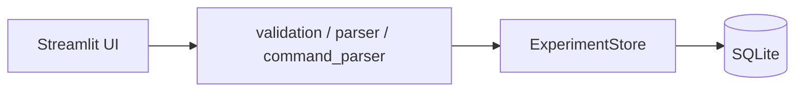
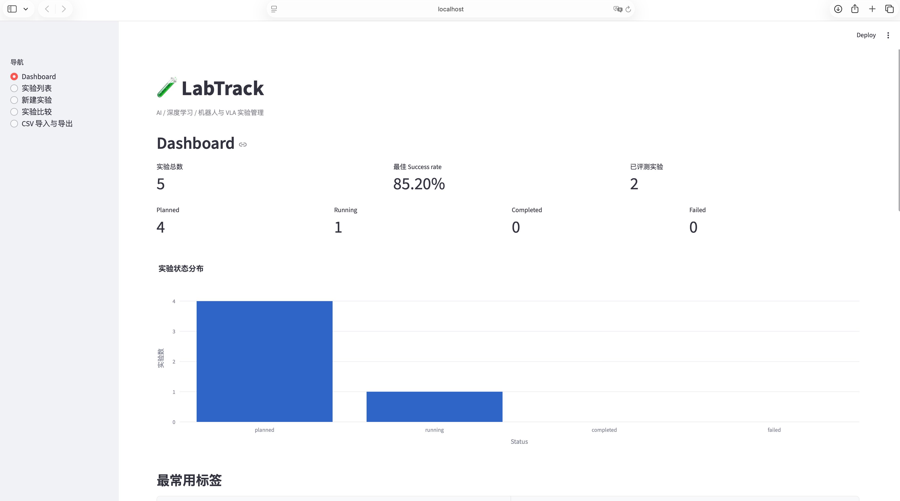
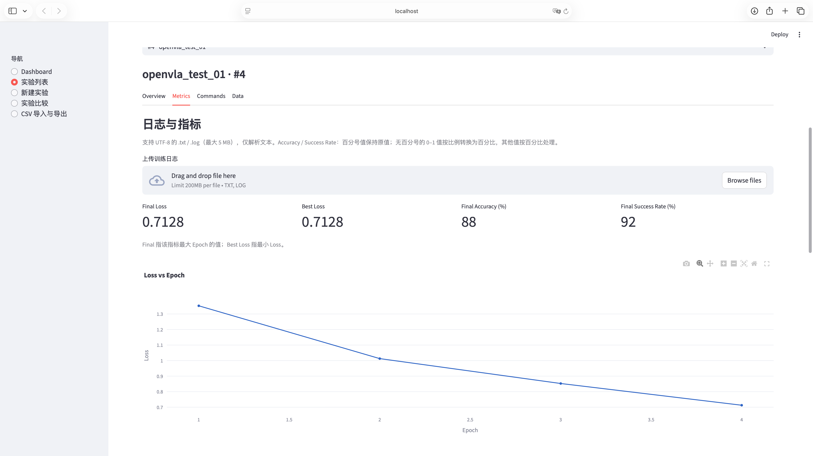
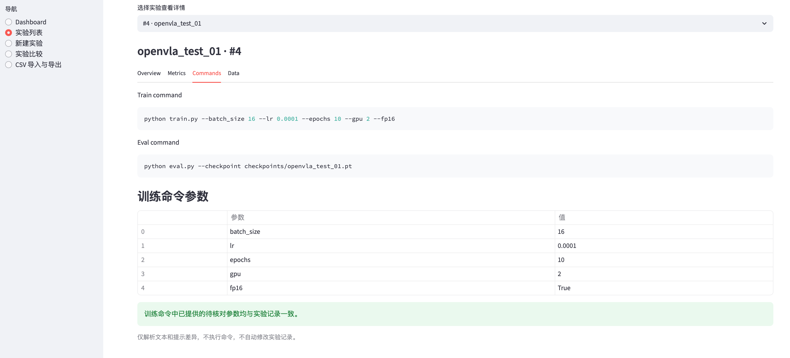

# LabTrack

LabTrack 是面向机器学习、深度学习和机器人 / VLA 的本地实验管理平台。它把分散在命令行、日志文件和笔记中的实验配置、训练指标与评测结果放在同一个可搜索、可比较、可导出的工作区，方便复现实验和追踪配置差异。

技术栈：**Python + Streamlit + SQLite + Pandas + Plotly**。无需独立数据库服务，也不需要训练框架集成。

## 核心功能

- 实验新增、编辑、删除与克隆，完整保存模型、数据集、超参数、GPU、路径、命令及备注。
- 四种实验状态与多标签管理，按名称、模型、日期、状态和标签组合筛选。
- Dashboard 统计、双实验配置与结果比较。
- 文本训练日志上传、指标持久化、Loss / LR / Accuracy / Success Rate 曲线和摘要。
- 训练命令参数解析与一致性检查，帮助发现记录与命令的配置差异。
- Markdown 实验报告、实验和指标 CSV 导出，以及全文件验证的原子 CSV 导入。

## 项目架构



`app.py` 负责导航和统一异常提示；`ui.py` 负责展示与交互；校验、日志解析、命令解析、CSV 与报告各自独立；`ExperimentStore` 负责事务、查询、兼容迁移和关联关系。第四阶段沿用现有数据库格式，不增加新表或新列。

## 📸 Screenshots

The following screenshots demonstrate the main features of LabTrack.

All experiments and metrics shown below are demonstration data.

### 1. Dashboard

Experiment overview, success rate statistics, and status visualization.



### 2. Training Metrics

Training log parsing, metric summaries, and interactive loss visualization.



### 3. Command Analysis

Training command parsing and hyperparameter consistency checking.



## 快速启动

推荐 Python 3.10–3.12（兼容最低 3.9）。在项目根目录运行：

```bash
python3 -m venv .venv
source .venv/bin/activate
python -m pip install -r requirements.txt
python -m streamlit run app.py --server.address 127.0.0.1
```

Windows 激活命令为 `.venv\Scripts\activate`。打开 http://localhost:8501 。首次运行自动创建 `data/labtrack.db`；关闭应用后数据仍会保留。

可通过 `LABTRACK_DB` 指定数据库文件（macOS / Linux 示例）：

```bash
LABTRACK_DB=/absolute/path/experiments.db python -m streamlit run app.py
```

## Docker

先安装并启动 Docker，然后在项目根目录运行：

```bash
docker build -t labtrack .
docker run -p 8501:8501 labtrack
```

打开 http://localhost:8501 。容器使用 Python 3.12、非 root 用户 UID 10001，并提供 HTTP 健康检查。镜像不包含本地用户数据库或 Streamlit secrets。

数据库固定放在 `/app/data/labtrack.db`，`/app/data` 声明为 volume。推荐使用具名 volume，便于删除 / 重建容器后复用同一份数据：

```bash
docker volume create labtrack-data
docker run --name labtrack -p 8501:8501 -v labtrack-data:/app/data labtrack
```

已有同名容器时先停止并移除旧容器，再用相同 volume 启动新容器；不要删除保存数据的 volume。基础 `docker run` 会创建匿名 volume，重新运行不会自动复用它。

如使用绑定目录 `-v /absolute/path/data:/app/data`，请确保该目录已存在，并允许容器 UID 10001 读写。挂载目录时数据库与示例文件以挂载内容为准。示例数据不会自动导入。

## 测试与 CI

```bash
python -m pytest -q
```

测试使用临时 SQLite 文件，不依赖、不修改真实用户数据库。覆盖 CRUD、状态与标签、旧库迁移、克隆、指标级联删除、日志解析、报告、CSV 原子导入及 Streamlit 操作流程。

GitHub Actions 在 push 和 pull_request 时自动 checkout、安装依赖并运行同一测试命令，矩阵覆盖 Python 3.10 与 3.12。CI 的默认数据库路径指向 runner 临时目录。工作流需将项目提交到 GitHub 后才会实际触发。

## 示例数据

```bash
python -m scripts.seed
```

导入 `data/examples.json` 中的三条示例实验，仅在空数据库中执行，已有数据时自动跳过。容器内可用 `docker exec labtrack python -m scripts.seed` 导入（具名 volume 初次创建时会包含镜像中的示例文件）。

- `data/example_training.log`：在详情 Metrics 中上传，体验日志解析和图表。
- `data/example_experiments.csv`：在侧栏 CSV 页面上传，体验验证、预览和确认导入。

示例性能值是虚构的测试数据，不代表实际模型表现。

## 实验详情与克隆

详情使用四个标签页：

| 标签页 | 内容 |
| --- | --- |
| Overview | 基本信息、Status、Tags、超参数、结果、备注及编辑表单 |
| Metrics | 日志上传、解析预览、摘要、曲线、指标明细和清空确认 |
| Commands | Train / Eval 命令、参数表和一致性检查 |
| Data | Markdown 报告下载、克隆与删除确认 |

在 Data 中点击「克隆实验」，复制配置、路径、命令、备注和标签，名称自动添加 `_copy`（重名时使用 `_copy_2` 等）。新实验设为 `planned`、success rate 为空，不复制指标、ID 或创建 / 更新时间；源实验保持不变。克隆后清除列表筛选并选择新实验，可在 Overview 中继续编辑。所有修改仍需点击保存。

## 截图

真实运行截图预留在 `docs/screenshots/`。当前尚无截图，因此这里不展示图片；后续可添加 Dashboard、Overview、Metrics、Commands 的真实截图，再将图片链接插入本节。

## 项目限制

平台面向个人本地使用，没有账号认证、权限控制、训练调度、进程监控或自动指标采集。所有训练 / 评测命令和日志只作为文本处理，不会执行。状态需手动维护，原始日志文件不归档；SQLite 不适合大量并发写入或多个应用副本共享。

日志和 CSV 支持 UTF-8（可含 BOM），单文件最大 5 MB；解析器只覆盖下文列明格式。CSV 导入只新增基础实验记录，不恢复原 ID、时间或指标。跨数据集、评测协议的结果需要自行确认可比性；完整备份请使用 SQLite 文件。

## 功能与操作

- **Dashboard**：实验总数、已评测数量、最佳 success rate、最近五个实验、状态数量与分布、最常用标签、结果图和每日实验数量图。
- **新建实验**：填写名称、模型、数据集、batch size、learning rate、epochs、GPU、checkpoint path、训练命令、评测命令、success rate 和备注。
- **实验列表**：名称和模型支持子串搜索，可组合 UTC 创建日期、状态和标签筛选；选择实验即可查看完整详情及命令一致性提示。
- **编辑与删除**：在 Overview 中展开编辑表单；删除必须先勾选确认。更新保留创建时间，并记录更新时间。
- **实验比较**：选择恰好两个实验，查看参数与结果表、success rate 图，以及结果差异（百分点）。

名称、模型、数据集必填；batch size 和 epochs 为正整数，learning rate 为有限正数。success rate 统一采用 **0–100 百分比**，例如 85.2 表示 85.2%；尚未评测时取消勾选「已完成评测」，以空值保存，与 0% 区分。图表和最佳结果忽略未评测数据。

日期保存与筛选均使用 **UTC**，筛选包含开始和结束日期。路径和命令仅作为文本记录，平台不运行训练 / 评测命令，也不自动读取 checkpoint。不同数据集和评测协议的结果需要自行确认可比性。

## 项目结构

```text
LabTrack/
├── app.py                    # 页面路由与操作流程、错误提示
├── labtrack/
│   ├── __init__.py
│   ├── database.py           # SQLite 初始化、参数化 CRUD 与查询
│   ├── validation.py         # 数据校验与字段定义
│   ├── ui.py                 # 复用表单、详情、日志上传与指标图表
│   ├── parser.py             # 纯文本日志解析与上传校验
│   ├── command_parser.py     # 训练命令解析与一致性检查
│   ├── import_export.py      # CSV 导出、完整文件验证与导入入口
│   └── report.py             # 指标摘要与 Markdown 报告
├── data/
│   ├── examples.json         # 示例数据
│   ├── example_training.log  # 可上传体验的示例日志
│   ├── example_experiments.csv # 可导入的实验基础信息示例
│   └── labtrack.db           # 运行时生成，不提交版本管理
├── scripts/
│   └── seed.py               # 示例数据导入
├── tests/
│   ├── test_database.py      # 持久化、CRUD、筛选、非法输入
│   ├── test_app.py           # Streamlit 页面、日志导入与用户操作流程
│   ├── test_parser.py        # 日志格式、非法数值与编码校验
│   ├── test_metrics.py       # 指标持久化、级联删除、旧库升级
│   ├── test_report.py        # 摘要与 Markdown 报告
│   ├── test_status_tags.py   # 状态、标签生命周期与真实旧库迁移
│   ├── test_command_parser.py # 命令格式、错误与参数一致性
│   ├── test_import_export.py # CSV 往返、非法输入与事务回滚
│   └── test_clone.py         # 克隆配置、结果重置与事务回滚
├── Dockerfile                # 容器构建、启动与健康检查
├── .dockerignore             # 排除本地数据库与开发文件
├── .github/workflows/tests.yml # push / PR 测试矩阵
├── docs/screenshots/         # 真实截图预留目录
├── requirements.txt
├── .gitignore
└── README.md
```

## 数据与故障处理

SQLite 写入使用事务、参数化 SQL 和数据库约束；连接及时关闭，锁等待时间为 10 秒。输入错误在页面提示，数据库和文件系统错误显示可操作提示，并将详细信息写入启动终端。遇到读写错误时检查 `LABTRACK_DB`、目录权限、磁盘空间以及其他进程是否长时间占用数据库。

备份时先停止应用，再复制数据库文件；恢复时同样先停止应用并替换文件。删除不可撤销，建议定期备份。该 MVP 面向本地使用，没有身份认证、权限控制、训练调度或自动指标采集，部署到多人可访问环境之前需要补充这些能力。


## 训练日志与实验指标

在「实验列表」选择实验后，详情的 Metrics 标签页支持上传 `.txt` 或 `.log`。文件需为 UTF-8（支持 BOM）纯文本，最大 5 MB。可使用 `data/example_training.log` 体验完整流程。

1. 上传文件，查看解析统计、提示和指标预览。上传本身不会写入数据库。
2. 点击「保存日志指标」。默认合并到已有指标，同一 Epoch、同名指标更新原值，重复保存不会生成重复记录。
3. 如果勾选「保存时替换该实验的全部已有指标」，保存会在同一个事务中清除旧记录并写入新记录。没有有效指标或校验失败时，已有数据保持不变。
4. 保存后展示实际存在的 Loss、Learning Rate、Accuracy、Success Rate 曲线、指标明细与摘要。可在「清空训练指标」中确认并清空；实验基本信息不受影响。
5. 在 Data 标签页点击「导出实验报告」，下载 UTF-8 Markdown 文件，包含实验信息、超参数、命令、手动结果、指标摘要、备注及创建和更新时间。没有训练指标时也可导出。

### 支持的日志格式

解析器逐行识别，每条指标所在行需包含明确的整数 Epoch，可含总 Epoch 数。指标名称不区分大小写，名称与数值用冒号或等号分隔：

```text
Epoch 1/8, Loss: 1.3526, LR: 0.001
Epoch 2/8, Loss: 1.0128, LR: 0.001
Epoch 3, loss=0.8526, learning rate=1e-4, accuracy=0.85, success rate=90%
Epoch 4, loss=0.7128, lr=0.0001, acc=88%, success_rate=0.92
```

支持 `loss`、`lr` / `learning rate` / `learning_rate`、`accuracy` / `acc`、`success rate` / `success_rate`，支持科学计数法。Epoch 可以从 0 开始；同一文件重复出现同一 Epoch 的同名指标时取最后一个有效值，并显示提示。未包含 Epoch 的行会跳过，不跨行推断 Epoch；这是一个范围明确、便于扩展的解析器，不支持任意日志语法。

**Accuracy / Success Rate 的单位规则**：带 `%` 的数值按百分比保存；无 `%` 的 0–1 数值按比例乘以 100；大于 1 的数值按百分比保存。例如 `accuracy=0.85` 和 `accuracy=85%` 都保存为 85。无百分号的 `1` 表示 100%，如果实际为 1%，应写为 `1%`。上传前请核对单位，避免歧义。Loss 与 LR 保持原值，允许非负有限数；超范围百分比、负数、NaN / Infinity 或无法识别的值不会保存。

部分行无法解析时仍可保存已识别指标，页面会列出提示和跳过行数；完全无法解析、非文本或编码错误时显示明确提示，不会清除已有指标。平台不执行日志中的任何命令，当前仅保存解析后的指标，不归档原始日志文件。

**摘要定义**：Final Loss / Accuracy / Success Rate 分别取该指标最大 Epoch 的数值（不要求出现在最后一行）；Best Loss 取最小 Loss。不存在的指标不展示、不伪造。日志中的 Success Rate 与实验表中手动填写的评测结果分别保留；Dashboard 和实验比较继续使用手动结果，不会因日志上传而改变。

指标保存在独立的 `experiment_metrics` 表（`id`、`experiment_id`、`step`、`metric_name`、`metric_value`），由外键关联实验并启用级联删除。已有第一阶段数据库会在启动时自动新增该表，原有实验字段和数据保留。保存或清空指标会更新实验的更新时间。无需新增依赖。


## 状态、标签与数据交换

### Status

新建或编辑表单中的 Status 可选择 `planned`、`running`、`completed` 或 `failed`，默认 `planned`。列表和详情显示状态，列表可按状态筛选。Dashboard 显示四种状态的数量（含 0）与分布图。状态由用户维护，不根据日志或 success rate 自动推断，也没有训练进程监控。

### Tags

新建和编辑表单支持多个标签，用英文 / 中文逗号或换行分隔。自动去除前后空格、重复项和空项，大小写敏感（`VLA` 与 `vla` 是不同标签）。标签不允许包含竖线或换行符，竖线用于 CSV 分隔。标签显示在列表与详情，列表支持按单个标签精确筛选，并可与名称、模型、状态、日期组合使用。Dashboard 按引用实验数显示前十个最常用标签。

数据库使用 `tags(id, name)` 和 `experiment_tags(experiment_id, tag_id)` 多对多结构，不在实验表中拼接标签字符串。删除实验会级联删除关联关系和训练指标，但保留标签实体，包括被其他实验引用的标签。未使用标签不会出现在筛选器或热门标签中；代码层提供 `ExperimentStore.cleanup_unused_tags()`，只删除完全未引用的标签。

### 训练命令参数解析与一致性检查

详情的「训练命令参数」使用 `shlex` 按 POSIX 引号与转义规则拆分文本，支持：

```bash
python train.py \
  --batch_size 16 \
  --lr 0.0001 \
  --gpu 2 \
  --epochs=50 \
  --model "open vla" \
  --fp16
```

支持 `--key value`、`--key=value`、不带值的布尔 flag，以及反斜杠换行。重复同名参数取最后一次出现的值，单独 `--` 后停止解析参数。单引号、双引号和负数参数值可解析；不解析短参数、环境变量展开、命令替换或完整 shell 语法。管道、重定向和 shell 控制符会给出不支持提示；引号未闭合等错误也会明确提示。**平台始终只解析文本，绝不执行命令。**

一致性检查覆盖：

| 实验字段 | 命令参数 |
| --- | --- |
| batch_size | `--batch_size` / `--batch-size` |
| learning_rate | `--learning_rate` / `--learning-rate` / `--lr` |
| epochs | `--epochs` |
| gpu | `--gpu` |

Batch size、Epochs 按正整数核对，LR 按数值核对（`0.0001` 与 `1e-4` 相同），GPU 按去除首尾空格后的文本核对。记录中的 `A100` 与命令中的设备索引 `2` 会产生差异提示，需要用户判断其含义。多个 LR 别名都会检查；命令未提供的字段不会被判为匹配。如果未提供任何待核对参数，会提示无法确认一致性。平台只提示差异或非法命令值，不修改记录，也不把解析结果写回超参数。

Markdown 报告同步增加 Status、Tags、Parsed Training Arguments 和 Configuration Consistency；解析失败或无法检查时也保留相应说明。

### CSV 导出

侧栏进入「CSV 导入与导出」，下载全部实验或全部指标。文件采用 UTF-8 BOM，中文、逗号、引号和多行备注由标准 CSV 引号规则保留，空数据库也能导出含完整表头的文件。

`experiments.csv` 字段：

```text
id,name,model,dataset,status,tags,batch_size,learning_rate,epochs,gpu,checkpoint_path,train_command,eval_command,success_rate,notes,created_time,updated_time
```

每行一个实验，Tags 使用 `VLA|LIBERO|baseline`。空 success rate 表示尚未评测，0 表示 0%。

`experiment_metrics.csv` 字段：

```text
experiment_id,step,metric_name,metric_value
```

导出包含全部实验，不受实验列表的筛选条件影响。指标 CSV 用于分析与备份，当前不支持导入。

### CSV 导入

在同一页面上传实验 CSV（UTF-8，可含 BOM，最大 5 MB），流程为：解析完整文件 → 验证所有数据行 → 展示预览和错误 → 勾选确认 → 一次性新增实验。可使用 `data/example_experiments.csv` 体验。

必需表头：`name`、`model`、`dataset`、`batch_size`、`learning_rate`、`epochs`。其他字段可省略：状态默认 `planned`，标签和文本字段默认空，success rate 默认未评测。存在 status 列时每行必须填写有效状态；空状态也会报错。标签用 `|` 分隔，同样去空白、去重和去空项。

输入验证与表单使用相同规则：必填文本、SQLite 范围内正整数、有限正 LR、0–100 success rate、四种有效状态。显示所有已发现的行级错误，指出数据记录行号、字段和原因（表头计作第 1 行；多行引用字段仍计作一条数据行）。结构错误、编码错误、重复表头也阻止导入。页面最多展示前 100 条错误，但整个文件都会验证。未知额外列忽略，不会映射到数据库。

**只要存在任何非法行，整个文件都不写入。** 数据库批量入口还会再次验证全部记录；实验与标签创建位于一个事务内，写入中途失败也会整体回滚。CSV 中的 `id`、`created_time`、`updated_time` 不参与恢复，导入时分配新的 ID 和当前 UTC 时间；不覆盖或更新既有实验，不导入指标。重复确认导入同一文件会新增另一组实验，因此 CSV 导入适用于基础记录交换，不是完整数据库恢复工具。完整备份 / 恢复仍请使用 SQLite 文件。

### 数据库迁移与兼容性

启动时检查 `PRAGMA table_info(experiments)`；若缺少 status，执行带 `NOT NULL`、四种状态约束和 `DEFAULT 'planned'` 的 `ALTER TABLE ... ADD COLUMN`。旧记录默认 `planned`，ID、创建 / 更新时间、其他字段和已有指标均保留。仅新增标签表及关联表，绝不删除或重建原有实验表。迁移可重复运行，并在事务中串行处理；所有连接继续启用外键。

升级不需要新增 Python 依赖。建议升级前停止应用并复制现有 SQLite 文件作为备份，然后按原命令启动。原有 CRUD、Dashboard、双实验比较、日志导入、指标曲线与 Markdown 下载继续可用。
